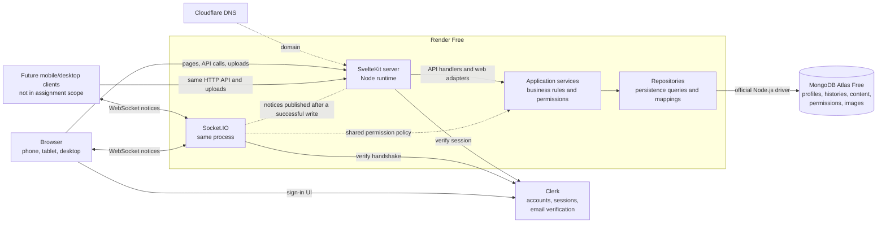
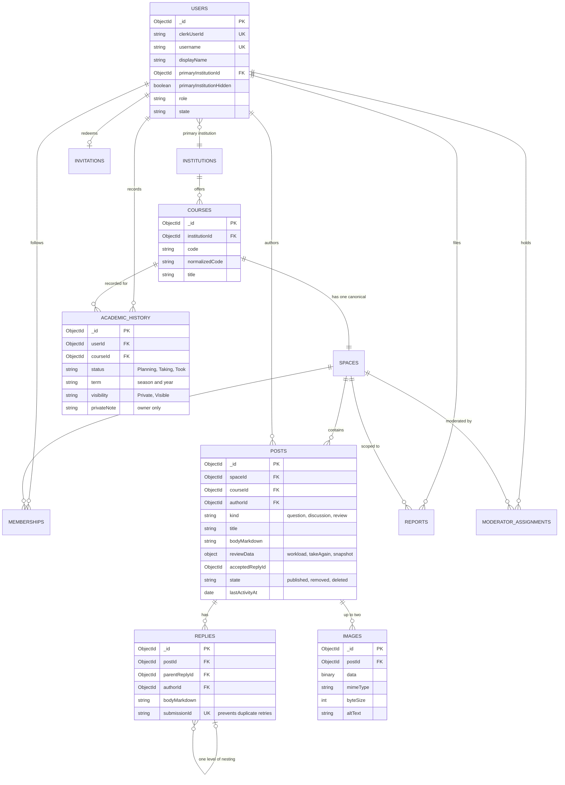
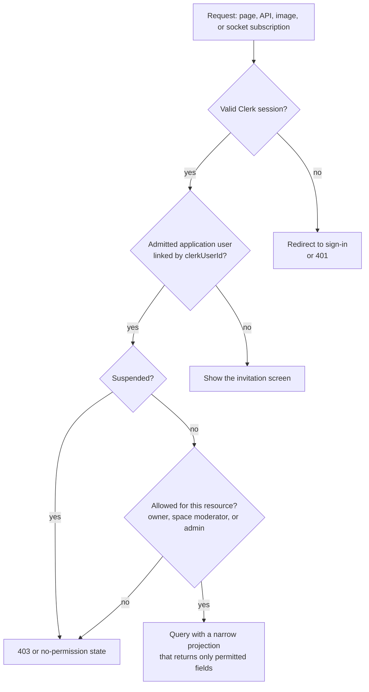
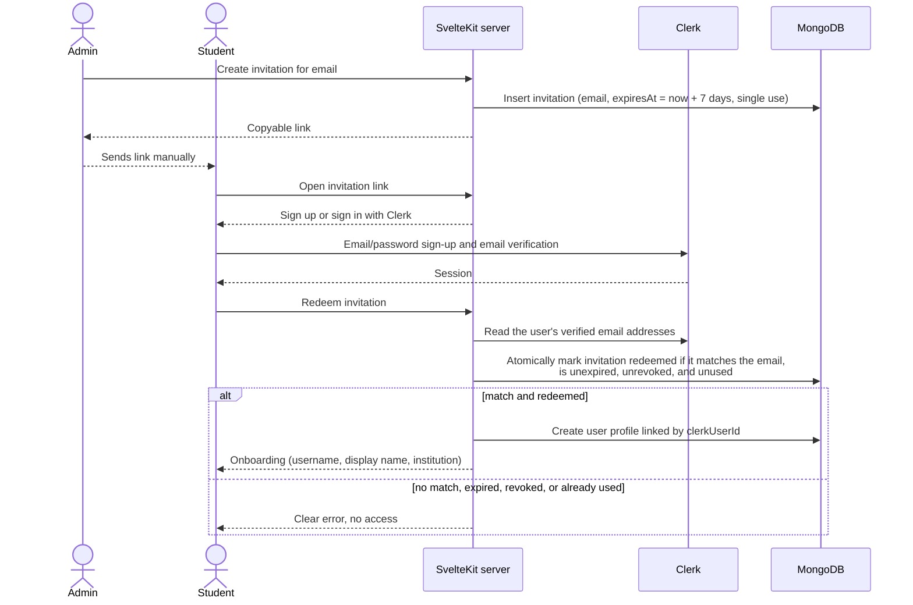
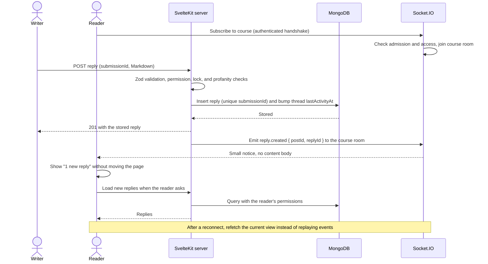
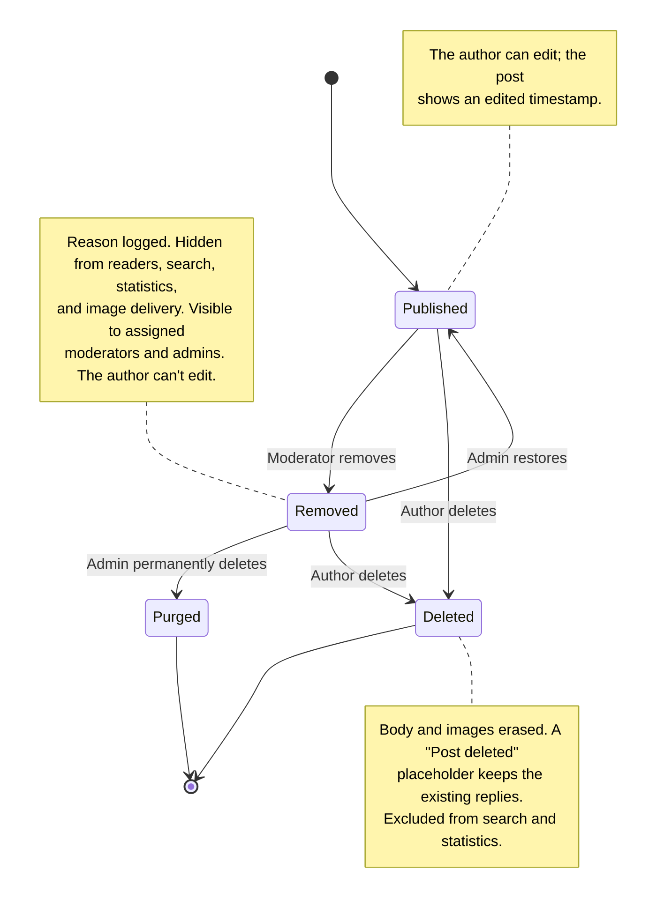
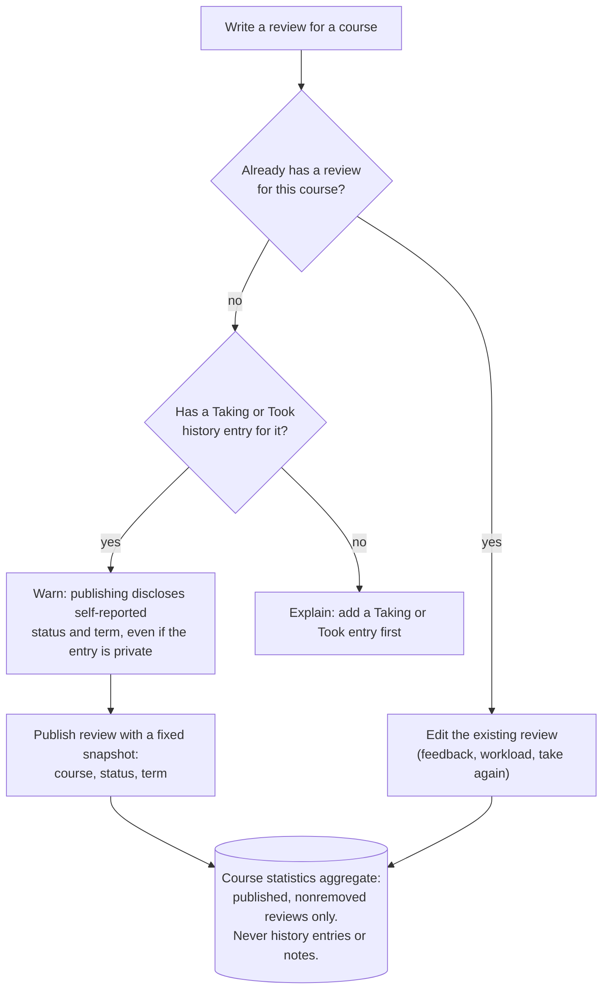

# Diagrams

**Status:** Drawn from the planning docs, November 5, 2026. These diagrams show the plan, not a verified implementation. If a diagram disagrees with the [product spec](../product/product-spec.md) or the [decision register](../planning/decision-register.md), those documents win, and the diagram needs fixing.

## System context

What runs where, and which service owns what. Clerk owns identity, MongoDB owns everything the application decides, and the browser never talks to MongoDB directly.

Updated November 7, 2026: one repository and one deployable application, with an HTTP API in front of the server services. The native clients below are possible future additions, not part of the assignment. So far only invitations use the API.

## Collections and relationships

Candidate model from the [MongoDB model](mongodb-model.md). D16 is still open: `ACADEMIC_HISTORY` may become an array embedded in `USERS` instead of its own collection. The relationships stay the same either way.

Collections not drawn: `institutions`, `spaces`, `memberships`, `reports`, and `moderatorAssignments` are small and shown only as relationships. `moderationActions` (audit log) and `profanityTerms` don't relate to content by key.

## Every request passes the same checks

Pages, API routes, image requests, and socket subscriptions all go through the same chain. Each step is a server-side check, not something the Svelte component decides.

Owner-only data, meaning private history entries and notes, fails the permission check for everyone else, administrators included.

## Invitation and admission

An admin creates an application invitation in MongoDB. Clerk proves the person owns an email address, and the application then checks that the email matches the invitation. The link alone proves nothing.

## Writing content and the realtime notice

HTTP saves the data, and the socket only announces that something changed. Clients refetch from MongoDB, so a missed event never loses content.

## Post lifecycle

How moderator removal and author deletion interact, from the [product spec](../product/product-spec.md#moderation-and-deletion).

Account deletion is separate: it anonymizes the user's remaining posts and reviews as "Deleted user" without changing their state.

## Review eligibility and statistics

Who can publish a review, and what goes into course statistics.

